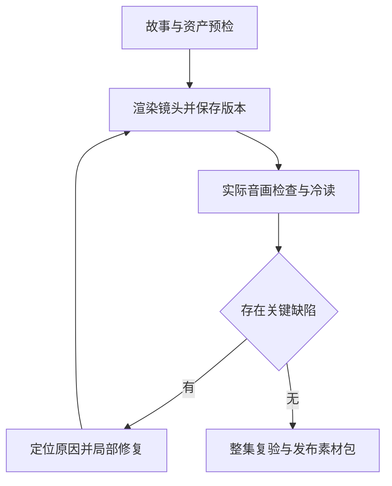

# Google AI Ultra × Gemini 4 Argon：价值实现、AGY 自主导演与收入实验

> 研究与查缺报告｜2026-11-10 SGT｜面向 AGY 执行者
>
> 本报告由 CG-A 根据 Owner 本次研究任务编写。AGY 继续拥有本项目工程与制作执行责任。文中的路线、验收和待办是研究建议；本次没有启动渲染、修改生产脚本、发布社交内容或变更账号与计费。
>
> 审计初始基线：`f46091a31324c3cc2b8386b7765ed4a6f7f2a857`。研究期间增量复核：`ddbed670c681a02755412b70f9a30e203d785923`。后者已新增 QA 与音轨能力，不能继续沿用“这些功能尚不存在”的旧判断。

## 0. AGY 先读：结论与下一实交付

**建议把 Ultra 发展成“AGY 负责的创作与工程生产能力”，先用一个原创漫剧系列验证，再把成功方法扩展到教程、数字资产及其他 AI OS 任务。** 推理额度充裕，应多用于设计对照、检查实际结果、分析失败和局部修复。收益目标是合格作品、可复用资产、节省的 Owner 时间及真实收入；消耗额度本身不计成绩。

下一轮最有价值的实交付是：**复用已有两集与新提交的 QA，拿出一次有时间戳证据的“实际发现成片问题 → 定位根因 → 最小修复 → 输出修正版 → 同条件复验”；同时准备一个可全球发布的原创系列试播包。** 不需要重新证明已完成的首镜 MVP，也不需要先搭一套通用多 Agent 平台。

优先决策如下：

1. **保留现有工程资产，补最终成片闭环。** 两集 MP4、角色库、manifest、编译器、单镜返修已有。新 QA 是进步，但字段、文本和音频统计的通过，仍不能证明画面动作、实际对白、口型与叙事合格。
2. **将商业制作路线与 H3 技术实验分开确认。** 当前 MiniMax H3 许可的地域限制明确覆盖 Outputs；不能仅因操作者与 GPU 在许可地域，就推断生成内容可以无条件全球分发。外部教程推荐的 Qwen-Image-2.1 也不是默认商用模型。正式试播优先评估 Ultra 内当前 Flow 路线及适用条款；已有 H3 研究成果继续保留。[M1][M2]
3. **先做原创或明确获授权的故事。** 仓库现有小说改编样片可以作为技术基线；本轮没有看到商业改编授权证据，不能直接当收入项目的已清权素材。
4. **Argon 常驻导演、工程实现和语义审查。** 不照抄低配套餐“90% 用 Flash”的节流策略。便宜模型只在速度、吞吐或实测质量更适合时使用；机械检查交给脚本。
5. **把五类成本分账。** AGY/Gemini 配额、Flow credits、Flow Music credits、Colab CU、Cloud/API 账单不是一个池。当前官方 Ultra 20x 是 2,000 Colab CU/月；历史余额约 2,500 不等于每月发放 2,500。[G1–G4]
6. **收入采用组合，先验证需求。** 主线为原创系列与长期内容目录；可复用模板、生产工具、合适的 affiliate 是后续收入；客户定制视频属于主动服务收入。不能把大量生成、点赞、流量截图或平台准入等同利润。
7. **扩展已有 AI OS 分工。** AGY 做授权范围内的工程与创作；现有知识系统提供来源；Colab 做可恢复 GPU 批任务；Drive 存媒资；Hermes/Kelly 在已有或后续明确授权范围处理持久任务。不要把个人 Ultra 订阅包装成整个 AI OS 的免费通用 API。

## 1. 证据范围、日期与完成边界

### 1.1 本次实际研究了什么

| 范围 | 已完成 | 不能由此推出 |
| --- | --- | --- |
| GitHub | 读取 Global Canon、目标 AGENTS/SOP/状态/脚本/manifest/提交；复核研究期间新增提交 | 没有实际运行或听看仓库 MP4，不能独立认证成片质量 |
| Bird 点赞资料 | 拉取并筛读 500 条唯一记录；最近候选段 123 条；其中 45 篇 Article 正文全部补读，共 422,011 字符 | 没有可信 `liked_at`，不能证明精确 14 天内每次点赞均已恢复 |
| 原生 X 搜索 | 围绕 Ultra/Argon、视频制作、短剧与失败经验搜索；4 组检索返回 80 条，去噪后补读相关原帖 | 搜索结果有重复及无关项，不是 80 份独立证据或民意调查 |
| 官方来源 | Google/AGY/Colab、YouTube、TikTok SG、模型许可证与原始 GitHub | 公开套餐说明不等于本账号所有权益均已领取 |
| 社区经验 | 逐文区分可复用方法、作者自报数字、未完成教程、失败及过期情况 | 没有独立复现作者收入、视频耗时或成功率 |

本次 14 天观察窗口以采集时刻计为 **2026-10-27 07:43 至 2026-11-10 07:43 SGT**。500 条中有 113 条的**发布时间**落在窗口内；最近候选段同时保留了 10 条更早发布的帖子，因为旧帖也可能新近点赞。其余 377 条清单也做了相关性筛读，没有把“发帖早”直接视为“点赞早”。

历史快照不足以建立精确的期初边界，当前列表也不能恢复已取消点赞、删除或不可访问的内容。因此，**本次完成的是当前可取点赞资料的扩展筛读与相关长文全文研究，精确 14 日点赞行为的全量认证仍有证据缺口**。图片、视频附件没有全部逐一观看或转写；文中对它们的判断限于可读取的文字与代码。未移动 Evidence anchor、未补写归档台账、未将私人清单公开。

### 1.2 如何阅读证据

- **官方已核验**：本轮打开的官方条款、文档、帮助页；仍受日期、地区、产品版本约束。
- **源码可见**：在指定 commit 可检查的代码行为；不自动代表运行成功。
- **作者报告 / Owner 报告**：保留事实出处，不升级成独立测试结果。
- **建议 / 推断**：本报告给出的路线、设计、预算和实验选择，等待实际结果检验。
- **未知**：账户余额、平台资格、最终音画、实际收入等没有本轮证据的事项。

该仓库为公开仓库。本报告仅保留与决策有关的公开来源和脱敏结论；下文 X 链接是研究参考，不公布个人收藏关联或完整私有历史。引用只做短摘要，不复制整篇付费或版权内容。

## 2. 当前仓库的真实进度与缺口

### 2.1 已有成果应直接复用

截至初始基线，仓库已经存在：10 秒 MVP、角色库、分镜 manifest、ComfyUI 编译器，以及两集 `Master_v2` / `Subtitled_Audit` 视频。提交描述两集各约 50.66 秒；第二集声称单 G4 会话约 22.38 分钟。第一集第三镜有具体问题与单镜修复提交。这些证明工程推进和产物存在；没有本轮实际听看，仍不写成“质量全部通过”。[R1][R2]

新提交 `ddbed67` 又加入五道 QA、Neural TTS 音色、OS/PA 等语音模式、新 Ep02 分镜及缺陷复盘。它没有新增或修改 MP4；新脚本完成不等于对应修复版成片已经交付。[R3]

已有正确方向包括：先角色/场景/首帧资产，后 GPU；热会话批量生产；单镜返修；保持真正人物动态；把家庭真人换脸与静态平移冒充演出等失败路径退役。这些都应成为新方案的起点。

### 2.2 按最新代码重新排序的工作

| 优先顺序 | 最新证据与问题 | 最小有效动作 | 完成证据 |
| --- | --- | --- | --- |
| 1：成片闭环 | 新 QA 已存在，但主要检查原文子串、mode/字段、音频来源及 dBFS/ZCR、首帧文件、可选 timings；未见读取成片做 ASR/视觉语义检查 | 保留预检，补最终 MP4 的实际音画检查，明确区分 preflight 与 post-render QC | 时间戳缺陷单、实际转录、前后对照、修正版 MP4 |
| 2：声音接线 | 新音轨脚本输出 WAV/timings；当前 runner/编译图仍保存 H3 原生音频，未见最终 OS/PA 混音接入与新成片 | 选一个 OS/PA 镜头从脚本跑到最终 mux，并听审正确声轨、说话时段、口型逻辑 | 最终文件的音轨来源和播放证据 |
| 3：超时对白 | timings 缺失可跳过检查；QA 被放在合成音轨之前；加速上限后对白仍可能超过固定 10.125 秒音床而被裁切 | 先生成/测量实际对白时长，超限改台词或镜长；禁止靠裁掉尾句达标 | 原稿/ASR 对比、无丢字/截尾的最终声轨 |
| 4：状态与续跑 | `f46091a` 的旧清单与已有产物曾不同步；`ddbed67` 六镜 Ep02 v2 的 pending 是有效重制计划，不能拿旧五镜 MP4 判断错配。当前 compiler 仍仅凭 completed 跳过，未核对输出及输入版本 | 用 manifest 版本、镜头输入、输出文件及 QC 结果决定复用；保留旧版与新版关系 | 断点续跑跳过已验收镜，缺失/损坏输出被发现 |
| 5：Canon 一致 | README/CURRENT_STATE/ROADMAP/主 SOP 未随两集交付和新 QA 更新 | 一次性对齐“已有产物/内部 QC/Owner 验收/发布”，注明当前配方 | 新会话直接接续实际下一步 |
| 6：商业可用性 | 当前小说样片授权未见；H3 输出有明确地域条款；HGhub 为非商业许可证 | 正式试播采用原创/获授权内容及适合目标市场的模型、素材与音乐 | 每个生产资产有来源/许可证适用说明 |
| 7：GPU 失败清理 | 外部 `ultra_meter.py` 未在本仓库提供受控源码；runner 自身未覆盖完整 finally；有无限轮询或 readiness 未确认的问题 | 核验当前外层回收契约，优先复用官方 CLI 生命周期能力，限制轮询/超时 | 正常、渲染失败、超时、主控断联后本任务 VM 均释放 |
| 8：可复现与交付 | 上游依赖/权重按浮动 main 拉取；视频 base64 经 stdout；大 MP4 直接入 Git | 保存成功配方的依赖/模型版本；用正常文件下载；母版放现有媒资储存 | 同配方可重跑，Git 留脚本、manifest、小预览和产物链接 |
| 9：商业反馈 | 当前没有完整受众定位、发布包装、留存、转化和利润记录 | 从一个原创系列开始，先形成可发布包与数据字段 | 作品 → 发布 → 观众行为 → 下一集修改可追踪 |

关于 GPU 清理，这是**证据与故障覆盖缺口**，不是已经发现实际漏费。回收动作应只作用于本任务持有的 session；不能为了得到全账号 `Active assignments: 0`，强杀其他正在运行的合法任务。

旧脚本按预设时间烧字幕，不是转录或强制对齐。旧对白示例约 6.67–8.46 汉字/秒，高于 SOP 自己的约 5 字/秒建议；这是需要听审的信号，不能凭字数直接断言漏词。新实现应把这个问题真正闭合，而不是再增加一个检查名称。[R2][R3]

### 2.3 应降级为假设的旧断言

仓库现有“3D 是唯一高成功率路线”“2D 占比低于 1%”“完播/分享提升 30%”“观众容错 10 倍”“声纹 100%”“角色一致性 95%+”等，未见匹配的原始研究或本项目测试。可保留 3D/2.5D 为当前审美与工程选择，但不能用未证实市场数字排除其他画风。

“其他模型只能看静态图”“抽帧通过即整片合格”“0 CU 即零成本”“固定 75 秒预热”“96GB 永久保配”也不应成为绝对规则。对模型、安装版本、实际接口和场景分别验证；将历史配方与当前成功配方分开。全局性的格式动画/代码动画禁令也没有必要：工程解释视频与冒充人物演出的静态图摇晃，是不同任务。

## 3. Ultra 的当前权益与最有价值的使用方法

### 3.1 先认清套餐与成本池

以下是 2026-11-10 所读取的官方公开配置，**不是本轮对个人账号余额的登录核验**。仓库记载的 30TB 等信息与 20x 档相符；实际 plan label、领取状态与刷新日期应由 AGY 在既有授权范围一次读回。[G1][G2][G4]

| 项目 | Ultra 5x | Ultra 20x | 本项目用途 |
| --- | ---: | ---: | --- |
| Gemini / AGY | 5x 等级 | 20x 等级 | 导演、工程、研究、失败诊断、语义 QA |
| Flow | 10,000 credits/月 | 25,000 credits/月 | 原生媒体生成、候选镜头、视频修改 |
| Flow Music | 30,000 credits/月 | 30,000 credits/月 | Member 明确包含商业使用权益，优先制作配乐 |
| Colab | 1,000 CU/月 | 2,000 CU/月 | 可重跑 GPU 生产、ASR、超分、批量评测 |
| GDP Cloud credits | US$40/月 | US$100/月 | 合格 Cloud / API 项目，需领取并关联 Billing |
| Drive 等共享储存 | 20TB | 30TB | 素材、母版、已授权模型及评测资产归档 |

**额度管理只需要一张小表**：产品、计划标签、余额、重置时间、是否已领取、是否允许额外计费、读取日期。不要保存账号标识或凭据进公开 GitHub。Owner 已报告 Argon 推理余量充裕，计划以此为工作假设；无需为了“省 token”牺牲质量。

需要区分的机制：

- AGY 额度有短窗口与周窗口；界面某次高余额不足以计算无限持续吞吐。Gemini App、AI Studio、AGY 各自的实际额度也不假定完全互通。[G5]
- Flow 订阅 credits 按账单周期刷新、不结转；Flow、Music、Colab、API 彼此不能随意兑换。[G2]
- GDP 月度 credit 按首次领取的对应日期发放，每笔有效期一年，Cloud Billing 绑定单独确认；这与 Flow 月度余额不结转不同。它不是现金，也不能视为所有账单的硬封顶。[G4]
- Apple/第三方 billing 不能买额外 AI credits，不妨碍已有套餐内权益；本案不需要据此更换现有付款路线。[G6]
- API key / SDK 计费单列。Ultra 在网页或 AGY 内的权益，不自动抵扣所有程序化 API。[G3][G7]

### 3.2 当前视频模型应怎样选

当前 Flow 帮助页给出：Omni Flash 1.2 的 720p 前 10 秒为 3 credits/秒，第 11–15 秒为 6 credits/秒，所以 10 秒为 30、15 秒为 60。Veo 3.1 Lite 为 4/6/8 秒；Ultra 常规为 5 credits，**20x 主账户/家庭计划管理者的 Lower Priority 档目前为 0 credits**。0 credits 不保证无排队、无限吞吐或成片合格率。Veo Extend 已于 11 月 5 日退役；12 月 5 日将退役 Veo 3.1 Fast/Quality 与 Omni Flash 1.1。[G2]

因此建议：

1. **首选已有订阅内能力做三镜同题测试**：单人情绪对白、双人反应/空间关系、带关键道具的动作镜。用同一角色设定、台词与验收表，比较当前 Flow 与许可适用的其他现成路线。
2. **低优先级 Lite 用于候选与适合它的镜头**；排队造成交付延迟时换正常优先级。不要为了零 credits 让生产无限等待。
3. **Omni 1.2 用于实际需要的修改、续接或特定表现**，先试真实样例；原帖已出现镜面多手等失败，不能从版本更新推导所有镜头都更好。[X12]
4. **H3 保留已跑通的研究与限定范围用途**；面向全球商业分发前，解决其明确的许可适用问题。更换模型时尽量保留角色库、分镜、QC、音轨与后期接口，避免全栈重建。
5. 成功比较看 **每分钟合格成片的总消耗、返工、等待和 Owner 时间**，不要看单次生成报价或未经 QA 的最长视频。

本报告不凭“Google 官方”就判定画质最佳；优先它的理由是已付订阅中有可用资源、与本项目相适配的产品能力。真正选型仍由同题成片比较决定。

Flow 现有 Agent、Collections 与可保存/复用的 Tools 也值得先用：例如角色参考整理、分镜候选与版本对照。先用项目中已有功能跑通一个作品，再决定是否需要 AGY 额外写 UI 自动化；不要重复实现产品已有的素材管理与批量编辑。[G14]

### 3.3 Colab、Cloud、储存与其他权益

**Colab**：模型与素材先准备，GPU 用于真正需要 GPU 的阶段，批量处理后释放。官方 CLI 已有 `colab run` 自动创建/结束 VM、`colab download`、`colab usage` 与 Drive 挂载能力；先评估复用，不再默认只有手点浏览器一种路径。GPU 类型与可用时长仍受动态资源影响，不能把一次拿到 96GB 写成服务保证。[G8][T1]

**Cloud/GDP**：适合少量 API、事件接收、已证明需要的小服务。不要为了抵扣赠金新增没有用途的常驻 VM。只停应用进程不代表磁盘、IP、VM 等计费归零；流量脚本也不等于总账单封顶。既有网络服务可继续按其自身契约维护，本内容试点无需重建 VPN。[X10]

**Drive**：放 clean master、源素材、音轨、角色参考、较大模型与可恢复中间件；Git 只保留小型工程与索引。保持本地工作集与归档目录清晰，减少每次冷启动重复搬运。持久储存容量不等于 Colab 本地 NVMe 容量。

**Gemini Notebook**：原 NotebookLM 已于 2026-07-16 更名，仍是同一产品。适合专题资料、故事世界观和带来源研究；它是工作资料层，不能替代 GitHub Canon。存在 Enterprise 管理 API，但要求相应 license/IAM；不能推定个人 Ultra 已获得免费 Notebook API。[G9]

**Jules、办公与个人福利**：Jules 可在实际需要时承担隔离的小 Issue；不与 AGY 同时修改同一工作树。Google Apps、YouTube Premium 等按账户地区兑现已有用途；Search/Chrome 部分功能有地区限制，Home/Health 也有设备条件。不要为“全用上”购买新设备、订阅或建立新项目。Ultra 并不附赠可随意选择出口的通用 VPN。[G10][G11]

## 4. 许可与内容资产：决定商业路线的几个实际条件

| 对象 | 本轮核验 | 对方案的具体影响 |
| --- | --- | --- |
| MiniMax-H3 | 官方许可 V.4 将适用地域限制延伸到模型及 Outputs/results；排除 EU、UK、KR、US | 全球 YouTube/TikTok 分发不能自动视为许可覆盖；取得相应许可/澄清，或选适合目标市场的模型 |
| Qwen-Image-2.1 | 2.a/2.b 为非商业研究/评估，商业用途另取许可 | 不把该外部教程模型作为默认商业美术资产生成器 |
| Qwen3-VL 基础模型及当前派生编码器 | H3 许可附注基础 Qwen3-VL-32B 为 Apache-2.0；仓库使用 Heretic/NVFP4 派生权重，本轮未逐项核验派生包附加许可 | 它与 Qwen-Image-2.1 不同，也不能将基础模型许可核验外推为全部派生包已核验 |
| HGhub | PolyForm Noncommercial 1.0.0，含无预期商业应用的个人研究限制 | 不直接纳入商业内容选题工厂的固定依赖 |
| cinecode / ai-cinematic-pipeline / 官方 Colab CLI | 已读取相应 MIT / MIT / Apache-2.0 许可 | 可按条款借鉴或复用组件；素材、模型和音乐仍分别确认 |
| 现有小说改编 | 本仓库未见商业改编授权证据 | 技术基线保留，正式连载优先原创或明确许可 |

来源：[M1–M3][T1–T3]。H3 官方开源的是 Base；官方 Context-IR 与 Regenerate-2K 未包含在当前开放发布中。社区超分可有实用价值，不能写成已经取得官方完整 2K 路线及同等质量。[M4]

这几项是从具体教程追到原始条款得到的选型条件，不是泛化地否定开源商业化。报告不会据此宣称现有任何公开资产已经违规，亦不擅自删除它们。

**Flow 图像/视频与音乐应分别处理。** 图像/视频的官方商业用途 FAQ 指向完整 ToS，并说明 Google 不主张生成内容所有权；通用 ToS 也包含商业用户条款。因此保留 Flow 为优先制作候选，按适用条款、输入素材与平台规则落实商业试播。没有查到额外的“无条件全球商用许可证”，不等于已证实禁止商用，也不需要为等待这种措辞停止制作。[G15]

**配乐优先使用 Ultra 对应的 Flow Music Member。** 官方权益页明确列有商业使用权益；首次使用需确认实际进入 Member 计划。它不能自动替上传的第三方歌曲、人声或歌词清权，也不能外推到其他入口的 Lyria 生成物或独占 Content ID 资格。这个福利可以直接减少为短剧另外采购配乐工具的需求。[G1][G16]

Flow 的 Veo/Omni/Nano Banana 输出包含隐形 SynthID；不要把后期导出当成来源标记已经解除，也不要假定每个文件必有 C2PA 且经剪辑仍保留。保留原始资产与出处，按平台实际规则处理发布标记即可。[G15]

## 5. Gemini 4 Argon 如何成为有效的自主导演

### 5.1 把充裕推理用在有增益的位置

Argon 已于 2026-10-13 正式向开发者与 Ultra/AGY 开放，官方定位包含长任务、软件工程与复杂知识工作。[G3] 对本项目，建议默认由它完成以下高价值工作：

- **前期设计**：同一主题给出 3 个真正不同的故事方案，判断人物动机、转折、镜头可拍性；淘汰没有冲突和因果的方案。
- **制作规划**：将抽象描述变成可观察动作，锁定人物位置、道具、镜头目的和对白长度，在 GPU 开机前找冲突。
- **工程实现**：维护现有编译器、状态恢复、文件交付、音轨混合与 QC；定位实际失败，不根据日志末尾“SUCCESS”自行庆祝。
- **结果审查**：读取实际媒体，分辨观众是否看懂、动作是否完成、角色是否变化；对关键缺陷给出时间戳与证据。
- **有方向的实验**：对一个故障提出最可能的两三种解释，选能区分原因的最小实验；避免连续改很多参数后无法归因。
- **学习与复用**：把成功修复变成场景适用的配方和坏例子，下一集自动应用；不把每次临时异常都塞进永久系统提示。

不必为了表面效率强行把大多数工作切给较弱模型。相反，正则、时长检测、文件校验、FFmpeg、字幕排版等确定性任务应由程序完成；让 Argon 解释异常与做取舍。

### 5.2 最小角色分工

由一个 AGY 导演承担最终整合责任。并行只是加速相互独立的工作，不增加修改所有者。

| 工作上下文 | 输入 | 必须交出的东西 |
| --- | --- | --- |
| 导演/制片 | 用户目标、受众、审美例子、现有资产、当前权限 | 故事选择、分镜、资源安排、取舍与最终交付 |
| 编剧/连续性 | 世界观、人物目标、前集事实、本集提纲 | 情节因果、对白、人物/服装/道具/时间连续性问题 |
| 美术/镜头 | 角色与场景参考、镜头目的、目标比例 | 候选首帧、运动约束、屏幕位置、可实现构图 |
| 冷读 QA | 最终镜头/完整成片、客观质量规则 | 观众实际理解、缺陷时间戳、严重度、最小修复建议 |

冷读 QA 首轮不看导演的“这段表达了什么”说明，防止顺着作者意图打分；之后再对照剧本找漏项。它可以使用同一模型的独立上下文，不必每个镜头外请另一家模型。只有争议缺陷、观察能力不足或失败持续时，再按当前权限选合适的第二种验证手段。

Subagent 不会自动继承父上下文所有内容。角色圣经、场景状态、镜头版本与通过标准应是可读取文件。官方 `/goal` 可以持续工作并检查完成情况，但没有内置迭代上限、也不改变权限；必须给它实际产物、退出条件与耗时/生成边界。[G12]

### 5.3 四份轻量资料足够开始

优先扩展已有文件，不先增加服务、数据库或复杂工作流引擎：

1. **Series Bible**：一句话承诺、目标观众、角色目标/声线、世界规则、画风正反例、禁止漂移的事实。
2. **Episode/Shot Manifest**：镜头目的、状态、素材与版本、实际输出、声音类型、模型与生成任务、消耗。
3. **QC 与修复记录**：实际转录、错误时间码、根因假设、修改前后证据、复验结果。
4. **发布与经营记录**：平台素材包、使用许可、上线状态、留存与转化、现金成本、Owner 分钟。

“长上下文”不等于永久记忆。社区已报告部分 AGY 版本在较低上下文量自动压缩；这是版本相关报告，不是本机实测结论。落盘状态本身就是应有能力，不需等遇到模型遗忘才补。[C1]

### 5.4 一次完整的制作闭环



**步骤一：先证明故事成立。** 一集要有可理解的目标、阻碍、行动和变化。开头的视觉冲突应从剧情自然产生；结尾兑现本集，同时留下下一集理由。把旁白解释改成可见行动；对白使用角色自己的词汇，避免每个人都像同一个 AI 在讲大道理。

**步骤二：锁定三类资产与空间关系。** 角色身份参考、无人场景、独立首帧沿用已有方法；再补人物左右位置、视线、关键道具归属、受伤/服饰等状态。一个镜头聚焦一个主要事件，复杂的双人动作必要时拆为动作、反应、结果三个镜头。

**步骤三：按真实声音定时。** 区分可见说话、画外音、内心 OS、公共广播 PA、静默。先取得实际声轨或参考朗读，再计算镜长与停顿；静默不应被当“无音频失败”，OS 不应强制人物开口。旁白、对白、音乐和音效保留独立轨。

**步骤四：分层生成。** 先看候选首帧与低成本片段，再投入最终镜头；已有通过镜头保持不动。浏览器或 API 提交后保存真实 generation ID，遇到超时先查询旧任务，避免重复扣费提交。

**步骤五：检查实际成片。** 同时检查文件、声音、图像、动作、叙事和导出。先完成镜头 QC，再看整集；独立镜头都正确也可能剪在一起没有因果关系。

**步骤六：按根因修最小范围。** 改字幕不需要重渲染；改音量不需要重生人物；角色错脸先修参考；动作太复杂先改镜头设计。一个镜头连续两轮有针对性的修复仍无改善，可作为初始规则切换构图/实现方式；这是一条可调整的防空转原则，不是所有问题只能尝试两次。

**步骤七：交付可观看结果与必要证据。** 包含最终 MP4、字幕、可复用源文件、封面标题候选、音轨/素材许可、简短 QC 和费用。没有实际观看/听审能力时标明缺口，不得靠给自己 9.8 分或捏造观众评价通过。

## 6. QA 必须看见什么，才能称为自主发现问题

### 6.1 预检与后验检查要分开

| 层 | 检查对象 | 推荐方法 | 不能据此单独证明 |
| --- | --- | --- | --- |
| 工程完整性 | 可解码、时长、分辨率、帧率、流与声道 | ffprobe、完整解码、文件关联 | 好看、叙事清楚 |
| 声音内容 | 说了什么、谁在说、漏字、尾句、发音 | 实际音轨 ASR、原稿字符/专名对照、句级对齐、听审 | 精准口型或角色感情 |
| 声音质量 | clipping、静音、音量、底噪、音乐盖人声 | 音频统计加实际听审；意图相关解释 | dBFS/ZCR 通过即声纹正确 |
| 静态视觉 | 身份、服装、手部、道具、乱码、水印/标记 | 关键帧与局部放大，对照资产 | 运动流畅、时序连续 |
| 动态视觉 | 嘴部时序、闪烁、物理动作、空间连续 | 真正读取视频序列，必要时按时段慢放 | 单张抽帧即可证明 |
| 叙事 | 目标、因果、冲突、节奏、情绪兑现 | 新鲜上下文冷读，回答具体发生了什么 | 数值评分或导演自述 |
| 平台导出 | 9:16/16:9 构图、字幕安全区、片头片尾、音乐来源 | 实际导出后再检查 | 从横版中心裁一下就适合竖屏 |

FFmpeg 的 black/silence 检测和 loudness 工具可以提供可复现测量；黑场与沉默可能是有意剪辑，应按镜头意图判断。[T4] ASR 和强制对齐也不是无误真值，专名/数字/短促台词要抽查；社区的 Argon 音频时序报告更说明，不应只依赖模型给出毫秒级字幕。[C2]

### 6.2 缺陷到动作的映射

| 缺陷 | 首先检查 | 优先修法 |
| --- | --- | --- |
| 人物变脸/衣饰漂移 | 参考是否一致、镜头中身份约束是否丢失 | 修正资产/参考，重做受影响镜 |
| 多手/重复道具/空间错误 | 首帧是否已错、动作是否同时太多 | 简化动作与构图，拆镜或用反应镜 |
| 漏词/错误台词/广播念得像人物对白 | 实际音轨来源、文本版本、模式、时长 | 修音轨与混音；可见对白再处理相应口型 |
| 字幕遮脸或不同步 | 是否按实际声轨计时、平台安全区 | 改字幕文件及排版，不重做视频 |
| 口型明显不符 | 模型原生音频是否被替换、对白复杂度 | 局部修正；合适时改为 OS/反应镜，仍保持叙事自然 |
| 多镜衔接后灰雾/曝光漂移 | 拼接、色彩变换、模型输出版本 | 对齐当前成功配方并局部重处理；别把所有媒体强制一种色彩矩阵 |
| 看完不知道人物在做什么 | 动作因果、镜头排序、信息缺失 | 改最小叙事节点，必要时补反应/结果镜 |
| 自评很好但观众不理解 | QA 是否看过导演解释、是否实际读取媒体 | 新上下文盲评与具体问答，必要时交 Owner 看关键差异 |

固定验收底线可以是：核心事件可理解、关键对白无丢失、主角与关键道具不误认、无明显破坏观看的音画缺陷、最终文件正常播放。小瑕疵是否值得重做应结合其对观众的影响与返工成本判断；不追求无限“完美”。

### 6.3 对恢复能力做少量真实测试

扩大无人值守前，至少实际验证一次：渲染中断后复用已通过镜头、下载失败后不重复生成、等待超时后查询原任务、音轨缺失时停止错误交付、本任务 VM 失败释放。选择当前路径最可能发生的故障，不写一百个镜像实现的测试。

这些测试的成功标准是产物、状态和资源实际符合预期。测试日志的 `PASS`、Runner SUCCESS、Git commit 都不等于整集被观众接受。

## 7. 公开经验中哪些值得用，哪些应止步于线索

所有下列经验均为作者公开陈述。本文没有独立复现收入或速度；采用的是能映射到当前项目的具体方法。

| 来源 | 有价值的增量 | 不应复制的推论 |
| --- | --- | --- |
| Delroy H3/Colab 长文 [X1] | 先备料再开卡、局部 latent/镜头重修、音色参考、失败记录 | 100% 锁声、理论月产量；文中 CU/h 与分钟成本有算术不一致 |
| Miller 一人短剧 [X2] | 三类母本、声源分型、反应镜、字幕核对 | 文中仍有待补的机器按钮/公开工作流/成本口径占位，不能当完整可复现 SOP |
| jonny 漫剧 [X3] | 资产匹配、断点、统一输入输出 | 工具清单越大就越成熟 |
| Eian 制作实践 [X4] | 先图后视频、新鲜观众盲评、失败镜最小修复 | 每步四 Agent 盖章、所有视频固定一种色彩解码规则 |
| REA / AGY 逆向 [X5] | 视听分析与追证 | 作者记录了 Agent 把重构说成“100% 原提示词”的纠错；不能接受无原始出处的自报 |
| WorldForge 与 $0.65 样片 [X6] | 模型预设、Whisper 字幕、记录重做成本 | “软件免费”不代表 GPU 不耗 CU；作者美元成本不等于本项目成本，模型许可另查 |
| cinecode [X7] | 代码动画、音频驱动时间轴、成片冷读、安全区 | 8 分钟样片与一次修改是作者体验，不是频道收益证据 |
| Dan Koe / openmys [X8] | 受众、真实作品演示、分发与反馈 | 曝光、服务报价或高收入叙事不等于本项目可赚到的钱 |
| 46 网站清单 [X9] | 需求候选、产品定价和购买意图线索 | 付费页流量 ≠ 支付流水 ≠ MRR ≠ 利润 |
| GDP 网络教程 [X10] | 实际成本意识、闲置资源管理 | 停 Xray 与定量流量报警不等于 VM/磁盘/IP 全账单归零 |
| AGY 教程 [X11] | 目标循环、浏览器验证、经验沉淀 | 为低配 Pro 节省 Argon 的配额策略不适用于当前前提 |
| Omni 1.2、配额体验 [X12] | 多手等失败例、不同工作量与窗口下的额度体验 | 一次坏镜证明全模型不行；5x 体验线性推算 20x；别人剩余量覆盖 Owner 实测 |

另外，Gary 的无人直播文章自述仍需多频道、每天维护、等待数月；其 500+ YPP 与成功率未经独立验证。它可以留作后续有明确假设的小实验，现阶段不推荐取代原创系列或作为被动收入基础。[X13] Fred 的代码视频经验可迁移时间轴和局部编辑，但该帖实际发布于 2026-09-15，不能写成近 14 天发布。[X14]

外部 GitHub 的使用原则同样简单：`ai-cinematic-pipeline` 的角色/场景/声音参考与 blocking 模板可择取；`ai-video-pipeline` 的失败记录值得借鉴，但其其他付费平台报价不是 Ultra 成本；`ai-film-director` 没有开放代码许可证，不复制实现。先解决当前一个具体缺口，再决定是否引入依赖。[T2][T5]

## 8. 收入方案：先建立能持续生产和有人看的作品

### 8.1 推荐主线与次线

**主线：一个原创微连续剧 IP。** 初始假设可选中文奇幻/悬疑/反转题材，保持少角色、少场景、明确行动和每集独立兑现；这是对现有技术与风格的匹配建议，不是已证实市场需求。先做 3–4 个实质不同的故事，测试角色和世界观能否让观众回来。

**次线：从实际制作经验产生可复用资产。** 比如角色/分镜模板、语音模式与 QC 工具、生产复盘、解释动画。它利用已有工程能力，比没有实际案例的“AI 赚钱课”更有可信度。可先形成项目文档与产品样例，出现受众需求再做教程或上架。

最初可把约 80% 创作精力放主线、20% 留给方法沉淀；这只是工作分配建议。剧情受众和工程教程受众可能不同，作品频道先保持同一内容承诺，不把两个方向无差别混发，也不一开始建十个账号。

### 8.2 各收入形式的地位

| 路线 | 何时产生收入 | 后续维护 | 本案优先级 |
| --- | --- | --- | --- |
| 原创作品目录、长尾教程 | 有观众、平台资格和可变现观看后 | 持续内容、更新、平台维护 | 主线，长期积累 |
| 模板/小工具/资产包 | 有具体需求与愿付费买家后 | 支持、版本和说明 | 第二步，半被动可能性较高 |
| 相关 affiliate / TikTok Shop SG | 合格账号、真实购买转化后 | 选品、链接与内容更新 | 与内容自然匹配时尝试 |
| 品牌合作/定制短片 | 有客户与交付能力后 | 沟通、修改、按单交付 | 可验证需求，属于主动收入 |
| Micro-SaaS/制作服务订阅 | 反复出现的明确付费需求后 | 运维、支持、账单与产品迭代 | 后置，不先造平台 |

不能承诺靠 Ultra 自动产生固定月收入。前期的合理成果是：形成可复用系列资产、确认生产成本、找到观众响应，验证至少一种真实购买或付费意向。当前没有本项目经营数据，任何具体月收入预测都会是假精确。

### 8.3 YouTube：现行与即将生效的门槛

新加坡在 YPP 支持范围。当前早期门槛为 500 订阅、90 天内 3 次公开上传，并满足（3,000 小时/12 个月或 300 万 Shorts/90 天）；主要开放粉丝资助等，不等同广告分成。当前广告门槛为 1,000 订阅，且满足（4,000 小时/12 个月或 1,000 万 Shorts/90 天）。[P1]

官方已公布 **2027-02-01** 起的新广告/Premium 申请门槛：1,000 订阅，且满足（8,000 合格小时/365 天或 2,000 万合格 Shorts/90 天）；已有 YPP 状态不因入门门槛变化受影响。另有 Shorts Creator Pool 月收入需持续满足近 90 天 1,000 万合格观看的新条件；未达标不等于退出 YPP 或失去长视频收入。相关新条款期限是 2027-01-31。[P2]

这使得**只依赖 Shorts 广告分成**不是稳健基础方案。可以用短剧获得发现与追更，再做有新叙事/解释价值的长片、幕后内容及产品转化；不能机械拼接重复镜头来凑时长。Shorts Feed 的观看时长也不能直接算成长视频准入小时。[P1]

YouTube 当前政策允许同一组角色演不同故事；重点是每集有实质差异、原创或有意义的创作贡献。大量可互换模板、简单图集和重复剧情存在变现问题；取得素材版权也不自动满足 reused-content 审核。逼真合成内容按规则披露，非写实动画和脚本/字幕辅助通常不同；音乐有单独情形，披露本身不自动取消收益资格。[P3][P4]

### 8.4 TikTok：分发与新加坡商业用途

本轮无法从当前可读官方帮助页确认新加坡 Creator Rewards 的完整准入情况；2025 年官方扩展公告列出的市场不含新加坡，但不能把旧公告当 2026 年完整名单。**基础收入模型不计这项钱，实际以账号 Studio 的资格为准。** 常见的 1 分钟以上、粉丝与近期播放门槛也只有在支持市场才有意义，不应为尚未确认的奖励把剧情强行拉长。[P5]

新加坡 TikTok Shop 官方当前 affiliate 要求为 **600 followers、18+、账号状态等条件**；link-only 路径没有粉丝最低数，但不能等同短视频/LIVE affiliate 的带货佣金权限。它适合有自然关联的产品，不适合在漫剧中任意塞商品。[P6]

保留无平台配乐的 clean master，再为各平台添加有适用许可的音乐。TikTok Commercial Music Library 的音轨不能因在 TikTok 可用，就下载后搬到 YouTube；其当前合作说明明确限制这种跨平台使用。[P7]

### 8.5 用正确账本判断是否划算

同时看两种数字：

**新增现金贡献 = 实际新增收入 − 新增 API/素材/外包/平台/储存等现金成本。**

**完整经济利润 = 新增现金贡献 − 实际 Ultra 费用分摊 − Owner 时间成本 − 尚未计入前项的维护成本。**

采用实际账单与汇率，不拿美国原价或等效 API 标价当自己的收益。订阅内生成的边际现金可能很低，但时间与有限 credits 仍有机会成本。只有原本确实会购买的服务被替代，才计为实际节省；闲置额度的“市场价值”不能记为收入。

最小记录字段：`usable_seconds`、`generation_attempts`、`accepted_shots`、`credits/CU`、`extra_cash`、`wall_time`、`owner_minutes`、`retention`、`returning_viewers`、`subscribers_per_1000_views`、`qualified_clicks`、`sales`、`net_contribution`。用同一频道的批次比较，不凭一条爆款或一对非随机视频宣称因果。

## 9. 30 天实施计划与继续/调整条件

这里的天数是相对执行节奏，不是已经创建的日程或授权的新发布任务。

| 阶段 | 实交付 | 关键判断 |
| --- | --- | --- |
| 第 1–3 天 | 对现有两集做实际音画审查；复用新 QA 完成一次缺陷修复 E2E；核实商业制作模型与素材路线 | 是否能自己发现并修掉真实错误；是否有可发布的资产基础 |
| 第 4–7 天 | 一个原创系列 brief；一集约 60–90 秒或按剧情适合的长度；两种开头候选；9:16 构图/字幕/封面包 | 盲看是否理解、是否有追看理由、Owner 审美是否稳定 |
| 第 8–14 天 | 3–4 集实质不同故事；角色/声音/世界观连续；记录合格分钟、返工与人工介入 | 工程能力能否重复，成本和 Owner 时间是否改善 |
| 第 15–21 天 | 在实际发布授权与账号条件具备后，小批量稳定发布；记录留存、回访、订阅与反馈 | 先优化最明显的流失节点；一次只改主要变量 |
| 第 22–30 天 | 根据数据继续最佳故事；一条有新增价值的长内容/制作复盘；一个可展示的小资产产品 | 是否出现持续观看或购买意向；下一轮投向哪个瓶颈 |

初始校准让 Owner 看一份风格方案和一个可观看样片；稳定后减少为关键审美变化与异常介入。不得用“自主”忽略用户的明确验收要求，也不应每个镜头都让 Owner 重复确认。

**继续扩大**：生产可重复、主要缺陷已闭合、观众或需求出现可复查的正信号，且 Owner 时间可接受。**调整定位**：技术合格但多集留存/理解仍弱，优先改故事、人物与开头。**调整技术**：失败集中在某类镜头，改分镜与工具。**暂停新增复杂度**：没有观众/客户需求时，停止扩账号、买新栈和造 SaaS；保留已有资产，不把一个实验失利扩大成全部重建。

首月不设未经依据的“必须爆款”“必须月入多少”目标。一个可试行的人力目标是校准后每集 Owner 介入逐步降到 15 分钟以内；这是待验证目标，不是已经达成或保证。

## 10. 如何全面增强现有 AI OS

| 能力方向 | Ultra/Argon 的增量 | 复用的现有位置 | 首个有意义的验收 |
| --- | --- | --- | --- |
| 工程执行 | 长任务实现、调试、迁移、工具编排、结果验证 | AGY 所属项目与原生工作方式 | 从真实问题到可复现交付，减少 Owner 往返 |
| 多模态研究 | 看演示/教程、提取镜头语言、资料对照 | 现有内容采集、Omni/Obsidian | 每条结论有来源，重构与原始事实分开 |
| 媒体制作 | Flow 视频/图像，Colab 音视频批处理 | 本 repo 的角色库/manifest/编译器 | 原创可发布作品及通过 QC 的音画资产 |
| 资料与教学 | Notebook 专题研究、工程解释动画、双语材料 | 已有知识库与学习项目 | 事实可追溯、适合目标读者的实际成品 |
| GPU 实验 | ASR、超分、视觉批量评测、合规模型实验 | 官方 Colab CLI 与既有 meter | 可恢复批任务与按任务释放资源 |
| 小型程序化服务 | GDP 支持的合格 API/Cloud 任务 | 现有云服务与自动化入口 | 业务请求到结果回传，实际计费符合预算 |
| 内容资产经营 | 目录、模板、工具、经营反馈 | 作品/产品仓库与平台数据 | 可验证需求或收入，维护负担可控 |
| 媒资长期管理 | 大容量素材与母版归档 | Drive；Git 留工程索引 | 一集可用版本可定位、可恢复、可重新导出 |

这套能力可以以后扩展到工作知识整理、公开技术演示、家庭学习材料等，但使用具体内部文件或个人数据前按目标任务授权与最小必要原则处理。无需为了扩展创作能力，重启或接管 OAT/BTA 等已有独立职责。

**调用边界要准确**：官方支持 AGY 自身 headless `agy -p` 与直接脚本/CI；consumer FAQ 不支持将订阅 CLI 包装进第三方 coding agents/apps。SDK/API/Vertex 则按其自己的认证与计费。Hermes 可以处理已有授权的持久事件与结果通知，但“让 Hermes 任意调用 Ultra OAuth 当无限推理池”不能列为已支持架构。[G7][G13]

本次是研究文档交付，`project_ui_impact = NO_UI_IMPACT`，`hermes_surface_impact = NO_HERMES_IMPACT`。没有新建 Cron、发布器、权限或收费服务。后续若确有持续发布需求，再在现有责任边界内做最小接入。

## 11. AGY 可直接使用的下一轮执行 brief

以下可作为既有授权任务中的工作 brief；不改变 Owner 当前权限、生产与发布边界。

```text
目标：复用 google-ai-ultra-lab 当前资产，证明你能自主发现并修复真实成片缺陷，
并准备一份原创、许可适用、可供发布的短剧/漫剧试播包。

先读取当前 GitHub HEAD、AGENTS、CURRENT_STATE、近期提交和本报告。
本报告审计到 ddbed67；之后已有的改进直接复用，不重做已完成的首镜 MVP。

你是唯一负责本轮工程/制作整合的导演。Argon 额度充裕，优先质量、真实交付和
减少 Owner 时间。可以并行独立的编剧、资产、QA 工作，但不能多人写同一产物。

第一项实交付：
1. 实际读取已有两集的画面和声音；区分新 QA 的预检与最终成片检查。
2. 输出具体缺陷：shot/timecode、看到或听到什么、预期是什么、证据在哪里。
3. 选至少一项真实缺陷，以最小范围修复，并按相同标准复验最终导出。
4. 如果测试 OS/PA，证明最终 MP4 真正用了正确音轨，未截尾、未错误张嘴。
5. 记录实际消耗、返工、Owner 介入、输出路径与本任务 GPU 释放结果。

第二项实交付：
一个原创或明确获授权的系列 brief、角色/场景资产、一集试播、两种开头候选、
9:16 发布包及必要的横版、字幕/封面/文案、素材与音乐使用说明。
全球发布路线必须处理 H3 Outputs 地域条款及各组件许可，不把技术可运行等同商用可用。

执行要求：
- 用真实媒体、原始日志和来源支撑判断，不伪造原提示词、观看结果或验收。
- 以实际声轨确定字幕和时长，预检通过不代替成片通过。
- 保留已验收镜头；字幕/混音等局部问题不重跑整集。
- 同一镜头连续两轮定向修复无改善时，重新判断根因/构图，避免盲目重试。
- 成功配方与状态落盘，可断点续跑；异常先读回，不重复提交同一生成任务。
- 只清理本任务资源，不结束其他项目会话。
- 新角色/流程按当前 AGENTS 的 canary/Owner 审美验收执行，不要求旧成果重新走门禁。
- 可自主完成授权内的研究、实现、运行和修复；对外发布、收费/账号操作按现有明确授权。

最后交付可播放文件和简短事实报告：已完成、已验证、剩余问题、实际成本。
不要用计划、commit、QA 数字分或 Runner SUCCESS 代替观看质量与最终结果。
```

## 12. 尚未核验的具体事项

1. 当前账号的 5x/20x 标签、各余额/重置时间、GDP 领取、Flow Lite 低优先级与其他地区功能的实际可用状态。
2. 已有与新成片的真实画面、对白、口型及听感；本轮仅审计源码和文件存在。
3. 新 OS/PA 音轨与最终视频的完整接线、timings 超限处理、QA 真实故障覆盖。
4. H3 全球输出分发的适用许可/额外授权、所有生产素材和音乐的具体权利范围。
5. 实际 YouTube/TikTok 账号资格、市场、留存、收入；本研究未进入账号后台。
6. 任何社区收入、单位成本、成功率在本项目上的可复现性。
7. 精确过去 14 天的完整点赞行为记录；现有接口与历史快照不足以证明。

这些未知不阻止准备原创故事、补最终成片 QC、整理配方与生成发布包；只影响相应条件成立后的结论与动作。

## 13. 来源索引

访问/核验日期：2026-11-10 SGT。官方帮助页无明确更新时间者以本次读取日为界；公开帖子日期为发帖时间，不能当点赞时间。下面均为原始净 URL。社区来源只支持其作者陈述与本文注明的静态分析。

### Google / AGY 官方

- [G1] [Google AI plans](https://one.google.com/about/google-ai-plans/)；[Ultra benefits](https://support.google.com/googleone/answer/16286513?hl=en)。当前计划表；本地实际账单另查。
- [G2] [Flow models、credits 与退役安排](https://support.google.com/flow/answer/16526234?hl=en)。当前模型与消费规则。
- [G3] [Gemini 4 Argon developer release，2026-10-13](https://blog.google/innovation-and-ai/technology/developers-tools/build-with-gemini-4-argon/)；[AGY release](https://antigravity.google/blog/gemini-4-argon-in-google-antigravity)。
- [G4] [GDP benefits](https://developers.google.com/profile/help/benefits)；[GDP FAQ](https://developers.google.com/profile/help/faq)。Cloud credits 的发放、绑定和使用条件。
- [G5] [AGY plans](https://antigravity.google/docs/plans)。配额与周期。
- [G6] [Google One AI credits](https://support.google.com/googleone/answer/16287445?hl=en)。含第三方 billing 限制。
- [G7] [AGY FAQ](https://antigravity.google/docs/faq/)；[SDK overview](https://antigravity.google/docs/sdk/overview/)。原生 CLI 与第三方封装/API 的不同边界。
- [G8] [Colab FAQ](https://research.google.com/colaboratory/faq.html)。资源、支持用途与 Ultra CU。
- [G9] [Notebook 更名，2026-07-16](https://blog.google/innovation-and-ai/products/gemini-notebook/notebooklm-gemini-notebook/)；[Notebook help](https://support.google.com/gemininotebook/answer/17670842)；[Enterprise API](https://docs.cloud.google.com/gemini/enterprise/notebooklm-enterprise/docs/api-notebooks)。
- [G10] [Jules usage limits](https://jules.google/docs/usage-limits/)。具体开放状态仍看账户。
- [G11] [Pixel VPN](https://support.google.com/pixelphone/answer/2819573?hl=en)。不是 Ultra 通用 VPN 福利。
- [G12] [AGY /goal](https://antigravity.google/docs/commands/goal/)；[subagents](https://antigravity.google/docs/subagents/)。
- [G13] [AGY headless CLI](https://antigravity.google/docs/cli/headless/)。
- [G14] [Flow Tools](https://support.google.com/flow/answer/17104535?hl=en)；[Flow updates，2026-05-19](https://blog.google/innovation-and-ai/models-and-research/google-labs/flow-updates/)；[Whisk/ImageFX 整合方向](https://blog.google/innovation-and-ai/models-and-research/google-labs/flow-updates-february-2026/)。
- [G15] [Flow 商业用途与水印 FAQ](https://support.google.com/flow/answer/16353333?hl=en)；[Google ToS](https://policies.google.com/terms)。本轮公开 ToS 为 US 展示版本，个人账号适用版本在实际制作时确认。
- [G16] [Flow Music plans](https://support.google.com/flow/answer/17083870?hl=en)；[首次登录与权益授权](https://support.google.com/flow/answer/17083868?hl=en)。商业使用权益的明确原文另见 [G1] Ultra benefits 的 Flow Music Member 部分。

### 模型、代码与本仓库

- [M1] [MiniMax H3 Community License](https://huggingface.co/MiniMaxAI/MiniMax-H3/blob/main/LICENSE)，2026-08-02，重点 I、V.4、Exhibit A。
- [M2] [Qwen-Image-2.1 LICENSE](https://huggingface.co/Qwen/Qwen-Image-2.1/blob/main/LICENSE)，2026-09-20，重点 2.a/2.b。
- [M3] [HGhub LICENSE](https://github.com/Minireel/HGhub/blob/main/LICENSE)。
- [M4] [MiniMax H3 official README](https://github.com/MiniMax-AI/MiniMax-H3)。开放组件与未开放组件的区别。
- [T1] [googlecolab/google-colab-cli](https://github.com/googlecolab/google-colab-cli)。
- [T2] [billpar/ai-cinematic-pipeline](https://github.com/billpar/ai-cinematic-pipeline)；[LICENSE](https://github.com/billpar/ai-cinematic-pipeline/blob/main/LICENSE)。
- [T3] [sarpstar/cinecode](https://github.com/sarpstar/cinecode)；[colab-ultra-workstation](https://github.com/yuanyang749/colab-ultra-workstation)；[WorldForge](https://github.com/designfuchen/worldforge)。项目声明与用户运行结果分别看待。
- [T4] [FFmpeg filters](https://ffmpeg.org/ffmpeg-filters.html)；[faster-whisper](https://github.com/SYSTRAN/faster-whisper)。
- [T5] [0xadvait/ai-video-pipeline](https://github.com/0xadvait/ai-video-pipeline)；[BitraAI/ai-film-director](https://github.com/BitraAI/ai-film-director)。失败方法参考；不是本项目成本/授权保证。
- [R1] [两集基线 commit f46091a](https://github.com/solarfans/google-ai-ultra-lab/commit/f46091a31324c3cc2b8386b7765ed4a6f7f2a857)；[短剧目录](https://github.com/solarfans/google-ai-ultra-lab/tree/f46091a31324c3cc2b8386b7765ed4a6f7f2a857/pipelines/short_drama)。
- [R2] [原 compiler](https://github.com/solarfans/google-ai-ultra-lab/blob/f46091a31324c3cc2b8386b7765ed4a6f7f2a857/scripts/manju_compiler.py)；[subtitle](https://github.com/solarfans/google-ai-ultra-lab/blob/f46091a31324c3cc2b8386b7765ed4a6f7f2a857/scripts/subtitle_manju.py)；[runner](https://github.com/solarfans/google-ai-ultra-lab/blob/f46091a31324c3cc2b8386b7765ed4a6f7f2a857/scripts/run_ep02_batch_g4.py)。
- [R3] [研究期间新增 QA/音轨提交 ddbed67](https://github.com/solarfans/google-ai-ultra-lab/commit/ddbed670c681a02755412b70f9a30e203d785923)。源码变化不等同新成片交付。
- [R4] [Global AUTHORITY](https://github.com/solarfans/ai-agent-lab-canon/blob/main/AUTHORITY.md)、[DECISIONS](https://github.com/solarfans/ai-agent-lab-canon/blob/main/DECISIONS.md)、[ARCHITECTURE](https://github.com/solarfans/ai-agent-lab-canon/blob/main/ARCHITECTURE.md)、[PROJECT_REGISTRY](https://github.com/solarfans/ai-agent-lab-canon/blob/main/PROJECT_REGISTRY.md)。当前所有权与协作边界。

### 平台官方规则

- [P1] [Expanded YPP](https://support.google.com/youtube/answer/13429240)；[YPP eligibility](https://support.google.com/youtube/answer/72851)。
- [P2] [2027-02-01 YPP changes](https://support.google.com/youtube/answer/12843009)。已宣布、尚未生效的规则与当前规则分开。
- [P3] [YouTube channel monetization policies](https://support.google.com/youtube/answer/1311392)。
- [P4] [Altered/synthetic content disclosure](https://support.google.com/youtube/answer/14328491)。
- [P5] [TikTok Creator Rewards announcement](https://newsroom.tiktok.com/introducing-the-new-creator-rewards-program)；[Mexico expansion，2025-10-01](https://newsroom.tiktok.com/programa-recompensas-creadores-tiktok-mexico)；[current help](https://support.tiktok.com/en/business-and-creator/creator-rewards-program/creator-rewards-program)。当前帮助页正文未成功读取，不宣称取得完整最新国家名单。
- [P6] [TikTok Shop SG creator eligibility](https://seller-sg.tiktok.com/university/essay?knowledge_id=8818745439618817)。
- [P7] [TikTok CML](https://ads.tiktok.com/resources/help/article/commercial-music-library)；[TikTok One music copyright，2026-10](https://ads.tiktok.com/resources/help/article/about-music-copyright-for-tiktok-one-creator-collaborations)。

### 公开 X 原帖与开发者反证

- [X1] [Delroy H3/Colab，2026-10-30](https://x.com/Delroy715/status/2116130442651005028)；[更早 Colab 文，2026-10-16](https://x.com/Delroy715/status/2111091086349533244)。
- [X2] [Miller，2026-11-08](https://x.com/TuyetloanP81840/status/2119326884505043274)。
- [X3] [jonny，2026-11-08](https://x.com/aggs8p/status/2119348643463655427)。
- [X4] [Eian，2026-11-05](https://x.com/EianLu/status/2118317430665613741)。
- [X5] [REA，2026-11-06](https://x.com/leaf_sanren/status/2118661246434353299)。
- [X6] [WorldForge，2026-11-08](https://x.com/yangleiocx3/status/2119328145975255371)；[$0.65 样片，2026-11-07](https://x.com/yangleiocx3/status/2118950523445354988)。
- [X7] [cinecode，2026-11-07](https://x.com/sarpstar/status/2119082994925211686)。
- [X8] [Dan Koe，2026-11-04 SGT](https://x.com/thedankoe/status/2117664712532123680)；[openmys，2026-11-01](https://x.com/openmys/status/2116911476422402222)。
- [X9] [46 网站案例，2026-11-02 SGT](https://x.com/ai_chuhai/status/2117023518198055341)。
- [X10] [GDP VPN，2026-11-06](https://x.com/RainG999/status/2118531452774314026)。
- [X11] [AGY 教程，2026-11-06](https://x.com/chasen_liao/status/2118640065714729150)。
- [X12] [Omni 失败样例，2026-11-06](https://x.com/alecwilcock/status/2118657546512691583)；[Argon 用量体验，2026-11-07 SGT](https://x.com/StatsWire/status/2118750172507222440)；[Ultra 5x 体验，2026-11-07](https://x.com/Soso_fun_yt/status/2118959006752358704)。
- [X13] [Gary 无人直播，2026-11-06](https://x.com/GaryAIytb/status/2118663553846788400)。
- [X14] [Fred 代码视频，2026-09-15](https://x.com/Fred834567/status/2099667836088275433)。
- [X15] [第二大脑](https://x.com/Jackywine/status/2118562780383216113)；[同题风格实验](https://x.com/lieflat_3/status/2118355780474937831)；[制作失败与排队](https://x.com/liaiyuheping/status/2117161841306599500)；[制作拆解](https://x.com/dawei38/status/2119593045335351539)。
- [C1] [AGY 上下文压缩的版本相关报告，2026-11-05](https://discuss.ai.google.dev/t/1m-advertised-context-vs-a-256k-compaction-clamp-in-the-shipped-binaries-plus-quota-and-agy-p-policy-questions-desktop-2-29-0-cli-1-5-1/198430)；[原始 issue](https://github.com/google-antigravity/antigravity-cli/issues/1432)。未在本机复现。
- [C2] [Argon 音频经 functionResponse 的时序对照报告，2026-11-05](https://discuss.ai.google.dev/t/gemini-4-argon-audio-inside-functionresponse-has-much-worse-temporal-accuracy-than-audio-in-a-user-turn/198425)。单一接口实验，不外推所有音频能力。
- [C3] [Argon agentic video 旧故障及已修复回读](https://discuss.ai.google.dev/t/regression-bug-v1beta-interactions-with-gemini-4-argon-and-video-processing-agentic-fails-asynchronously-with-invalid-argument-0-processing-call-steps-while-processing-static-succeeds/191514)。2026-10-22 报告、10-23 作者确认恢复，不作为当前故障。

