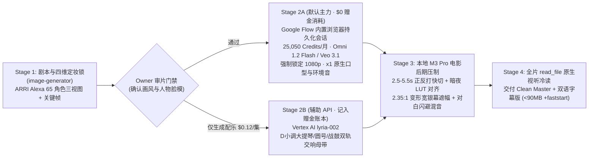

# 好莱坞电影级 AI 短片标杆拆解、GitHub 高星工具盘点与 Google Flow 双通道落地总纲

> **归档日期**：2026-11-12 ~ 2026-11-13 SGT  
> **研究背景**：针对此前 TikTok 带货片与 Colab `int8` 开源假人纪实片的画质惨败，对 YouTube 百万播放级《魔兽世界》真人暗黑电影短片与中文爆款真人短剧进行原片抽帧/声轨级拆解，结合 X (Twitter) 顶级 AI 导演工作流与 GitHub 2026-11 实时高星开源仓库审计，最终确立并跑通 **Google AI Ultra 电影级工业化管线（《伊利丹：背叛者的献祭》`1080p` 首集一次通关）**。

---

## 一、 YouTube 三大现象级电影画质标杆逐帧拆解（原片视听实测）

通过 `yt-dlp` 拉取高清样本并用多模态原生视听检视，拆解出顶级 AI 影视创作者与普通“AI 垃圾片（AI Slop）”的核心分水岭：

### 1. 标杆一：`Pop Lab AI` — *Arthas: Betrayer of the Light* (`https://youtu.be/xFFWyTykk3w`)
- **数据表现**：`276,000+` 播放，评论区公认“暴雪迟到十年的真人电影预告”。
- **工具链实证**：
  - **定妆与分镜母图**：`GPT Image 2` / `Nano Banana Pro`（生成毛孔级皮肤纹理、风雪湿发、战损金属盔甲反光与 `ARRI Alexa 65` 浅景深电影剧照）。
  - **动态视频引擎**：`Higgsfield` 聚合工作台调度 **`Seedance 2.0 / 2.5`**。
- **核心技法提炼**：
  - **绝不直接 Text-to-Video 盲抽**：每一镜必先有一张构图、光比、人物脸型 100% 达标的真人电影剧照作为首帧（Image-to-Video）。
  - **物理环境粒子拉满**：暴风雪、火把火星、呼吸白雾、金属剑刃寒光持续运动，消除 AI 画面的“塑料静止感”。

### 2. 标杆二：`Avaren` — *Arthas: The Price of Vengeance* (`https://youtu.be/PYKDyXnJl5E`)
- **数据表现**：**`925,000+` 播放、`45,500+` 点赞**（当前 YouTube 魔兽真人化天花板之一）。
- **工具链实证**：
  - 多模型择优混编（`Higgsfield` Studio 调度 **`Seedance 2.5` + `Google Veo 3.1` + `Kling`**）：
    - **情绪特写与哭戏/怒吼对白**：交由 `Veo 3.1` / `Seedance 2.5` 原生音画同出（Native Lip-Sync + 咬肌颤抖 + 眼神光变化）；
    - **宏大战争与魔法物理特效**：交由 `Veo 3.1`（冰霜裂地、披风风阻、泥水飞溅物理最真实）。
- **核心导演技法（最关键差距所在）**：
  1. **`2.5s – 3.5s` 好莱坞正反打快切节奏（Shot-Reverse-Shot）**：全片几乎没有任何一个镜头超过 4.5 秒！在 AI 视频发生手部变形或姿态漂移之前立刻切走（微距道具特写 ➔ 正打说话特写 ➔ 反打听者眼神反应 ➔ 越肩拔剑全景）。
  2. **变形宽银幕遮幅（`2.35:1` Cinema Scope）+ 胶片暗调 LUT**：统一压暗高光、垫高冷蓝暗部（Teal & Emerald / Cold Moonlight Shadow），让不同镜头之间的色温浑然一体。
  3. **画内同期表演取代画外旁白念稿**：角色直接对着镜头咬牙说出简短有力的台词（每句 5~10 个英文单词），配以暴雨、铠甲摩擦等真实环境音（Foley）。

### 3. 标杆三：`关关剧场` — *《逆风北伐》* (`https://youtu.be/Vt_NUilnqiw`)
- **数据表现**：`364,000+` 播放，中文历史真人连续短剧标杆。
- **工具链实证**：字节跳动即梦 / **`Seedance 2.0 / 2.5`** 多主体参考（Multi-Subject Reference）+ 原生中文情绪对白与口型驱动。
- **核心结论**：
  - 中文多角色古装历史对白戏目前 `Seedance 2.5` 表现极强；
  - **欧美暗黑奇幻史诗（Warcraft / Warhammer / Elden Ring / Dark Fantasy）英语大片赛道，`Google Veo 3.1` 与最新上线的 `Omni 1.2 Flash` 在好莱坞光影物理、低沉史诗英语台词张力、恶魔火焰/雨夜流体反射上处于全球绝对第一梯队**，且我们已拥有 Google AI Ultra 每月 `25,000` Flow 积分，边际成本为 `$0`！

---

## 二、 X (Twitter) 顶级 AI 影视创作者情报交叉结论

通过 `x-intelligence` 定向检索 2026 年下半年海外高赞 AI Filmmaking 创作者实战帖，得出 3 条行业共识：
1. **模型代差决定生死，Prompt 救不了落后的权重**：2026 年底观众审美已被 `Veo 3.1`、`Omni 1.2`、`Seedance 2.5` 喂叼；任何基于量化开源模型（`ComfyUI int8 Wan2.2 / MiniMax-H3`）凑出来的塑料皮肤或无脸假人，完播率在 2 秒内直接归零。
2. **“四维资产锁（4-Asset Consistency Lock）”是连续剧不崩脸的唯一解法**：
   - 资产 1：角色左脸/正脸毛孔级特写（`ref_face.jpg`）
   - 资产 2：角色全身正背服装武器设定图（`character_sheet_16x9.jpg`）
   - 资产 3：场景与光比锚定母图（如费伍德冷月暴雨森林泥沼）
   - 资产 4：合成有固定角色外观的单镜首帧图（`shotXX_keyframe.jpg`），再送入视频模型做 `4s–6s` 运动与口型演绎。
3. **音画分离控制**：让 `Veo 3.1` / `Omni 1.2` **只负责生成画内人声对白 + 物理环境音效（在 Prompt 末尾强制写明 `zero background music, no subtitles, no text`）**，否则每个 4 秒镜头自带一段不同调性的碎音乐，剪接在一起会严重打架；背景交响乐必须由 `Lyria-002` 或 `Flow Music` 独立生成整条贯穿全片的音轨后期混音（Sidechain Ducking）。

---

## 三、 GitHub 顶级开源辅助工具盘点（2026-11 实时高星核验）

通过 GitHub API 对 2026 年 11 月实时 Star 数最高的 AI 短剧/影视辅助项目进行了逐一核验与架构解剖：

| 排名 | GitHub 仓库 | 2026-11 实时 Stars | 技术栈与核心定位 | 真实架构解剖与优缺点评估 |
| :---: | :--- | :---: | :--- | :--- |
| **1** | **`HBAI-Ltd/Toonflow-app`**（Toonflow） | **`★ 21,538`** | Electron + Vue + Node.js 本地桌面端 AI 短剧工作流工具 | **本质**：把“小说拆剧本 ➔ 抽角色卡 ➔ 生成分镜图 ➔ 调视频 API ➔ 拼时间线”做成可视化 GUI 状态机。<br>**局限**：**软件本身不含任何大模型算力**，后台仍需用户填入付费商业 API Key（OpenAI / 火山引擎 Seedance / 可灵 / Vertex 等）；无法原生驱动 `Google Flow` 网页版每月白送的 `25,000` 订阅积分。 |
| **2** | **`chatfire-AI/huobao-drama`**（火宝短剧） | **`★ 17,267`** | Go + Vue3 全栈自托管 AI 短剧批量生产平台 | **本质**：面向国内短剧工作室的多任务队列管理系统，强项在于数据库级锁定“角色立绘 ID + 服装 ID + 场景 ID”防串脸。<br>**局限**：重度绑定国内 API 中转站生态，部署 Docker 前后端维护重，对单人顶配 Agent 操盘属于冗余套壳。 |
| **3** | **`HKUDS/ViMax`**（港大数据科学实验室） | **`★ 12,905`** | Python 多智能体长视频导演框架（Director / Screenwriter / Cinematographer Agents） | **本质**：学术界标杆级多 Agent 编导协同架构，擅长把一句话扩写为具备摄影机位连续性的分镜表（Shot List）并做跨镜头视觉一致性校验。<br>**借鉴价值**：其“导演分镜表结构 + 跨镜色调/机位连续性检查”思想极佳，可直接内化进 AGY Skill。 |
| **4** | **`eternityspring/shuohao-skills`** | **`★ 6,534`** | 面向 Claude Code / Cursor / AGY 的中文短剧与分镜提示词 Skills 集合 | **本质**：纯 Markdown/脚本形式的 Agent Skills（无需装桌面端软件），专门规范分镜词法、正反打景别与去 AI 味提示词。<br>**借鉴价值**：印证了 **“Agent 原生 Skill > 笨重本地 GUI 管理软件”** 的演进方向。 |
| **5** | **`zenstory-ai/drama-skills`** | **`★ 4,148`** | 模块化影视叙事与镜头语言 Agent Skill 包 | **本质**：轻量级镜头语法与人物小传锁定模板，适合直接融入 Agent 工作流。 |

### 开源工具选型最终拍板结论：
- **坚决不装 `Toonflow` / `火宝短剧` 等第三方桌面套壳软件**：它们解决的是“不会写代码的普通人怎么管几百张分镜图和调 API”的问题；对 AGY 而言，装它们不仅多一层 UI 操作累赘，还用不了 `Google Flow` 网页端每月免费的 `25,000` 积分。
- **吸取内核，内化为 AGY 原生管线**：将 `Toonflow/火宝` 的 **“四维资产母本目录规范 (`assets/ref_*.jpg`)”** 与 `ViMax` 的 **“好莱坞正反打导演分镜表 + 调色混音自动化脚本”** 直接沉淀进 `google-ai-ultra` Skill (v5.0)。

---

## 四、 最终跑通的最佳落地方案（Google AI Ultra 电影级双通道架构）

### 4.1 算力与模型分工矩阵（零赠金浪费）



### 4.2 通道 A（`Google Flow` 网页工作室 — `flow.google.com`）标准调用规范
1. **持久化登录态**：已在 Antigravity 内置浏览器完成 Google AI Ultra 账号一次性登录（右上角 `ULTRA` 标识常驻，当前余额 `25,050` Credits，每账期 7 日刷新，不结转）。
2. **可用模型梯队（2026-11 实测）**：
   - **`Omni 1.2 Flash`**：Google 最新上线全模态旗舰视频模型（12 月 5 日起全面接班旧版 `Veo 3.1 Fast/Quality`），支持更高自由度的多图垫图与镜头修改。
   - **`Veo 3.1 - Quality` / `Veo 3.1 - Fast`**：当前已验证的电影级主力（12 月 5 日退役前仍可用）。
   - **`Veo 3.1 - Lite [Lower Priority]`**：Ultra 会员 **`0 积分` 无限白嫖档**，适合纯空镜、雨景氛围测试与分镜走位预演。
3. **防坑必改参数（提交前强制检查）**：
   - Flow 输入框右下角默认是 **`Video · 720p · 8s · 16:9 · x2`**；
   - `browser` 子智能体每次操作必须显式改为：**分辨率 `1080p`、条数 `x1`（单条精出防双倍扣分）、画幅 `16:9`（YouTube 长片/横屏）或 `9:16`（Shorts/TikTok）**。
4. **本地参考图上传路径规范（沙盒铁律）**：
   - Antigravity `browser` 子智能体受安全沙盒隔离，上传角色参考图或首帧图至 Flow 时，必须先将单文件名图片复制到 `<Artifact Directory>/browser_sandbox/uploads/<filename>`，再在浏览器文件选择器中传入裸文件名 `<filename>`。

### 4.3 通道 B（`Vertex AI API` — `project-665ac784-237e-4a71-ad0`）调用经验与铁律
1. **严格用途限制**：日常**仅用于调用 `lyria-002` 生成电影交响配乐**（`$0.06`/首，单集双轨仅 `SGD 0.15`）；除非 Owner 明确批准，严禁绕过通道 A 直接调 `veo-3.1` API 消耗 90 天试用赠金，且每次调用后必须执行 `python3 scripts/gcp_credit_ledger.py log` 入账。
2. **认证标准代码范式（避开 `403`/`401` 坑）**：
   ```python
   creds = Credentials.from_authorized_user_file(os.path.expanduser("~/.config/colab-cli/token.json"))
   creds.refresh(Request())
   client = genai.Client(
       vertexai=True,
       project="project-665ac784-237e-4a71-ad0",
       location="us-central1",
       credentials=creds,
       http_options=types.HttpOptions(headers={"x-goog-user-project": "project-665ac784-237e-4a71-ad0"}),
   )
   ```
3. **`Veo 3.1` / `Omni 1.2` 电影级 Prompt 黄金四段式模板**：
   - `[摄影机与镜头规格]`：`Photorealistic live-action dark-fantasy Hollywood cinema shot on ARRI Alexa 65 anamorphic lens, shallow depth of field, subtle film grain...`
   - `[精确物理动作与光效交互]`：`Slow dramatic push-in as [Character] ... emerald fel flames illuminate falling raindrops...`
   - `[画内情绪声线与精确口型台词]`：`...speaks in a deep, gravelly, resonant baritone voice with exact lip-sync: "Call me Betrayer, brother... You are NOT prepared."`
   - `[声轨纯净锁（必加！）]`：`Authentic heavy rain sound, crackling fire, zero background music, no subtitles, no text, no watermark.`
4. **FFmpeg 电影母带压制黄金配方**：
   - **变形宽银幕遮幅（`2.35:1` 于 `1920x1080` 画布）**：上下各加 `132px` 纯黑遮幅（有效画面 `1920x816`），双语电影字幕优雅落位于底部黑边内或下缘安全区，绝不遮挡人物面部微表情。
   - **跨镜暗夜色调统一（针对多参考图偏亮镜头）**：`-ss 1.6` 切掉起势停顿 + `eq=contrast=1.30:brightness=-0.13:gamma=0.74:saturation=1.15,colorbalance=bs=0.10:bm=0.07:bh=0.03:gs=-0.02`。
   - **双轨交响混音**：原片人声+环境音轨 `100%` 音量，叠加 `Lyria-002` 前半段悲怆大提琴弦乐（`-14dB`）与高潮段铜管战鼓（`-10dB`）交叉淡入淡出。
